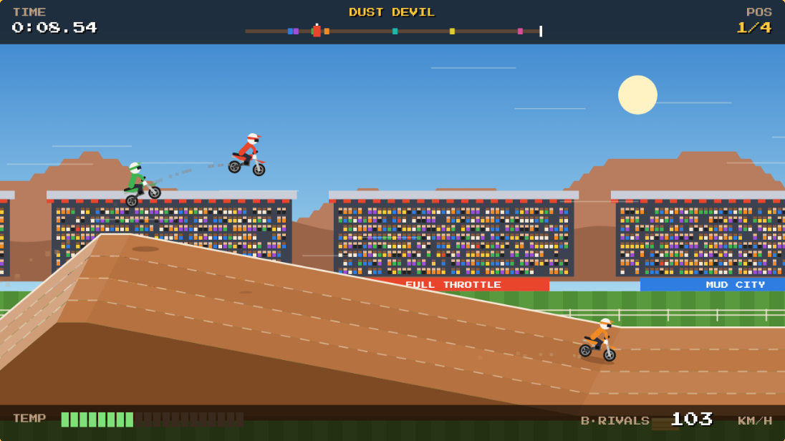
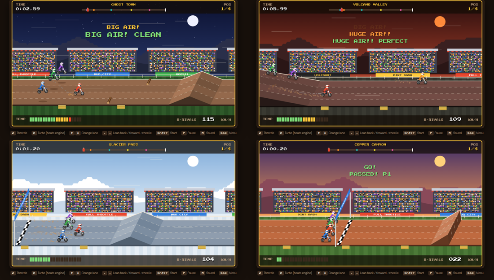

# Dirt Dash

A retro side-scrolling motocross racer for the browser, in the style of 1980s arcade dirt-bike games. Hit ramps, catch air, keep your engine from overheating, and race three rivals across 15 tracks.

**[Play it in your browser](https://grizzlypeaksoftware.github.io/dirt-dash/)**



## Controls

| Key | Action |
| --- | --- |
| **Z** | Throttle |
| **X** | Turbo: faster, but heats the engine |
| **↑ / ↓** | Change lane |
| **← / →** | Lean back or forward in the air. Hold **←** on the ground to wheelie. |
| **Enter** | Start race |
| **P** | Pause |
| **M** | Sound on/off |
| **Esc** | Back to the menu |

On phones and tablets, on-screen buttons appear below the game. Menus can also be clicked or tapped.

## How to ride

- **Landing:** match the bike's angle to the ground. Land nose-down and you crash. Land too nose-up and you lose speed or flip. A clean landing gives you a speed boost, and a long jump gets a "BIG AIR" or "HUGE AIR" callout.
- **Turbo heat:** turbo is the fastest way around, but the temperature gauge climbs. If it maxes out, the engine stalls for a few seconds. Ride over the **blue arrow strips** to cool it back to zero.
- **Hazards:** mud slows you down, logs crash you unless you wheelie over them, and running into another rider's back wheel crashes you. Landing on top of a rider knocks them over instead.
- **Gap jumps:** these launch you over a pit. Come up short and you hit the far wall.

## Modes

- **A: Solo time trial.** Beat the target times for 1st, 2nd or 3rd place.
- **B: Race 3 rivals.** Three rivals start on the line with you, and slower riders are spread around the track. You finish 1st to 4th by race position, with live position and passing callouts.

Your best time on each track and mode is saved in your browser.

## Tracks

There are 15 tracks across five difficulty levels, each with its own setting: red mesas, pine forest, desert, thunderstorm, alpine, sunset canyon, swamp, badlands, red clay, a ghost town at night, dusk, a moonlit bayou, a volcano, a glacier and the final Gauntlet.

The jumps include kickers, tables, doubles, triples, rollers, whoops, step-downs, gap jumps and mega jumps.



## Run it locally

The game is a single `index.html` with no build step and no dependencies. Open it in any modern browser:

```sh
git clone https://github.com/grizzlypeaksoftware/dirt-dash.git
cd dirt-dash
open index.html        # macOS. Use xdg-open on Linux or start on Windows.
```

To serve it over HTTP instead, run `python3 -m http.server` and open http://localhost:8000.

## Hosting on GitHub Pages

In the repo, go to **Settings → Pages** and choose **Deploy from a branch**, then **main** and **/ (root)**. GitHub serves `index.html` as the site.

## How it's built

- Plain JavaScript drawing on an HTML `<canvas>`, at 640×360 logical pixels scaled up.
- All art is drawn in code: the riders, bikes, crowd and scenery. There are no image assets.
- The track is drawn in an angled 3D-style view, with four lanes going back into the screen.
- Physics runs on a fixed 120 Hz timestep and handles ballistic jumps, landing-angle checks, slopes and lane changes.
- Sound effects, including the engine drone, are made in code with the Web Audio API.
- The pixel font is [Press Start 2P](https://fonts.google.com/specimen/Press+Start+2P) from Google Fonts.
